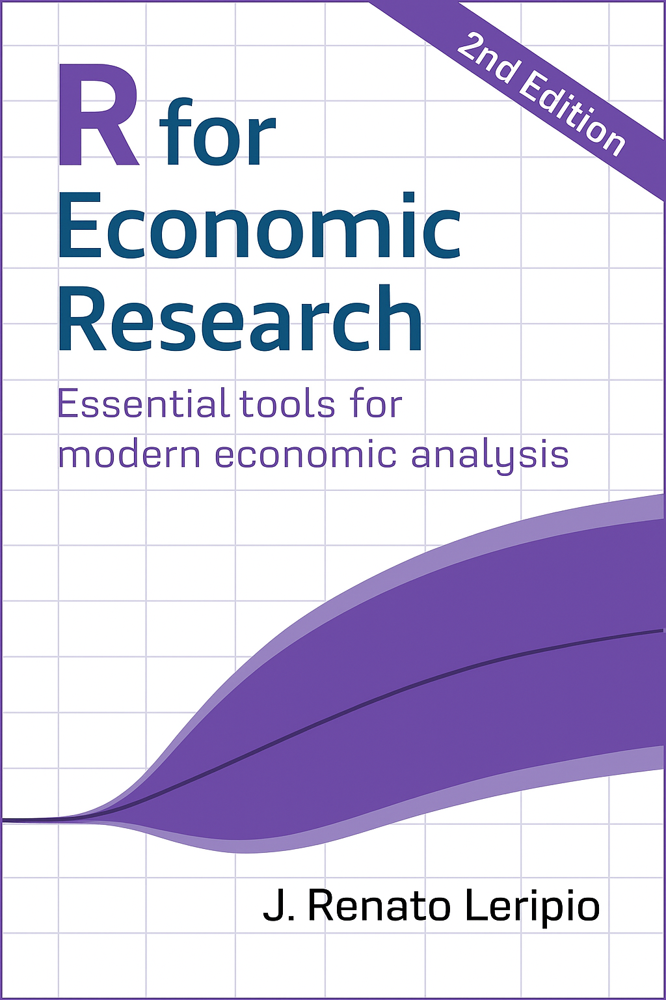

```{=html}
<div class="about-wrap">
  <section class="about-intro" aria-labelledby="profile-name">
    <div class="about-portrait">
      
    </div>
    <div class="about-identity">
      <h1 id="profile-name">João R. Leripio</h1>
      <p class="about-role">Previsão, Modelagem Estatística e Ciência de Dados</p>
      <div class="about-bio"><p>Sou especialista em previsão e modelagem estatística, com foco em séries temporais. Combinando economia e ciência de dados, desenvolvo modelos confiáveis e fluxos analíticos reproduzíveis para apoiar a pesquisa e a tomada de decisão. <a class="about-linkedin" href="https://linkedin.com/in/leripiorenato">Conecte-se comigo no LinkedIn ↗</a></p></div>
    </div>

  </section>

  <div class="about-card-grid">
    <section class="about-card about-work-card" id="work-with-me" aria-labelledby="work-title">
      <span class="section-kicker">Treinamentos · Consultoria · Projetos</span>
      <h2 id="work-title">Como posso ajudar</h2>
      <p>Tem um desafio com dados ou quer desenvolver sua equipe?
    Ofereço treinamentos, consultoria e desenvolvimento de projetos em previsão,
    modelagem estatística, ciência de dados e fluxos de pesquisa,
    pensado especialmente para os seus objetivos.</p>
      <a class="about-card-link" href="services-pt.qmd">Veja como podemos trabalhar juntos ↗</a>
    </section>

    <section class="about-card" aria-labelledby="book-title">
      <span class="section-kicker">Livro</span>
      <h2 id="book-title">R for Economic Research (2e)</h2>
      <div class="about-book-content">
        <p>A segunda edição, lançada em setembro de 2025, inclui novos capítulos sobre inferência bayesiana, nowcasting e análises de grandes volumes de dados.</p>
        <a href="https://book.rleripio.com" target="_blank" rel="noopener" class="about-book-cover" aria-label="R for Economic Research"></a>
      </div>
      <div class="about-book-links">
        <a class="about-card-link" href="https://book.rleripio.com" target="_blank" rel="noopener">Leia gratuitamente online ↗</a>
        <a class="about-card-link" href="https://www.amazon.com.br/Economic-Research-Essential-economic-analysis/dp/B0G5YD9HD3" target="_blank" rel="noopener">Compre na Amazon ↗</a>
      </div>
    </section>

    <section class="about-card" aria-labelledby="talk-title">
      <span class="section-kicker">Palestra mais recente</span>
      <h2 id="talk-title">Nowcasting When Predictors Keep Changing</h2>
      <p>Apresentada no 46º International Symposium on Forecasting.
    A palestra explora como produzir previsões confiáveis a partir de
    bases de dados de alta dimensão cuja composição muda
    continuamente ao longo do tempo.
    </p>
      <a class="about-card-link" href="talks-pt.qmd">Veja todas as palestras ↗</a>
    </section>

    <section class="about-card" aria-labelledby="current-title">
      <span class="section-kicker">Atualmente trabalhando em...</span>
      <h2 id="current-title">Projetos analíticos mais confiáveis</h2>
      <p>Um novo livro sobre como analistas podem ir além de análises pontuais
    e construir projetos analíticos confiáveis e duradouros. O livro reúne
    lições práticas sobre organização, automação e implantação de
    pipelines de dados e produtos analíticos para pesquisa aplicada.</p>
    </section>
  </div>
</div>
```
