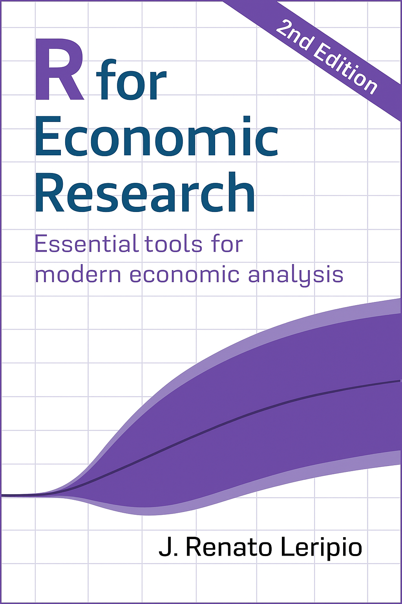

```{=html}
<div class="about-wrap">
  <section class="about-intro" aria-labelledby="profile-name">
    <div class="about-portrait">
      
    </div>
    <div class="about-identity">
      <h1 id="profile-name">João R. Leripio</h1>
      <p class="about-role">Forecasting, Statistical Modeling & Data Science</p>
      <div class="about-bio"><p>I specialize in forecasting and statistical modeling, with a focus on time series. Drawing on economics and data science, I build reliable models and reproducible analytical workflows to support research and decision-making. <a class="about-linkedin" href="https://linkedin.com/in/leripiorenato">Connect with me on LinkedIn ↗</a></p></div>
    </div>

  </section>

  <div class="about-card-grid">
    <section class="about-card about-work-card" id="work-with-me" aria-labelledby="work-title">
      <span class="section-kicker">Training · Consulting · Projects</span>
      <h2 id="work-title">How I can help</h2>
      <p>Have an analytical challenge or a team you’d like to develop?
    I offer training, consulting, and project development in forecasting,
    statistical modeling, data science, and research workflows,
    with support tailored to your goals.</p>
      <a class="about-card-link" href="services.qmd">Explore how we can work together ↗</a>
    </section>

    <section class="about-card" aria-labelledby="book-title">
      <span class="section-kicker">Book</span>
      <h2 id="book-title">R for Economic Research (2e)</h2>
      <div class="about-book-content">
        <p>The second edition, released in September 2025, includes new chapters on Bayesian inference, nowcasting, and working with big data.</p>
        <a href="https://book.rleripio.com" target="_blank" rel="noopener" class="about-book-cover" aria-label="R for Economic Research"></a>
      </div>
      <div class="about-book-links">
        <a class="about-card-link" href="https://book.rleripio.com" target="_blank" rel="noopener">Read online for free ↗</a>
        <a class="about-card-link" href="https://www.amazon.com.br/Economic-Research-Essential-economic-analysis/dp/B0G5YD9HD3" target="_blank" rel="noopener">Buy on Amazon ↗</a>
      </div>
    </section>

    <section class="about-card" aria-labelledby="talk-title">
      <span class="section-kicker">Latest talk</span>
      <h2 id="talk-title">Nowcasting When Predictors Keep Changing</h2>
      <p>Presented at the 46th International Symposium on Forecasting.
    The talk explores how to produce reliable forecasts from
    high-dimensional datasets whose composition changes continuously
    over time.
    </p>
      <a class="about-card-link" href="talks.qmd">See all talks ↗</a>
    </section>

    <section class="about-card" aria-labelledby="current-title">
      <span class="section-kicker">Currently working on...</span>
      <h2 id="current-title">Building better analytical projects</h2>
      <p>A new book about how analysts can move beyond one-off analyses
    and build reliable, long-lived analytical projects. The book brings
    together practical lessons on organizing, automating, and deploying
    data pipelines and analytical products for applied research.</p>
    </section>
  </div>
</div>
```
